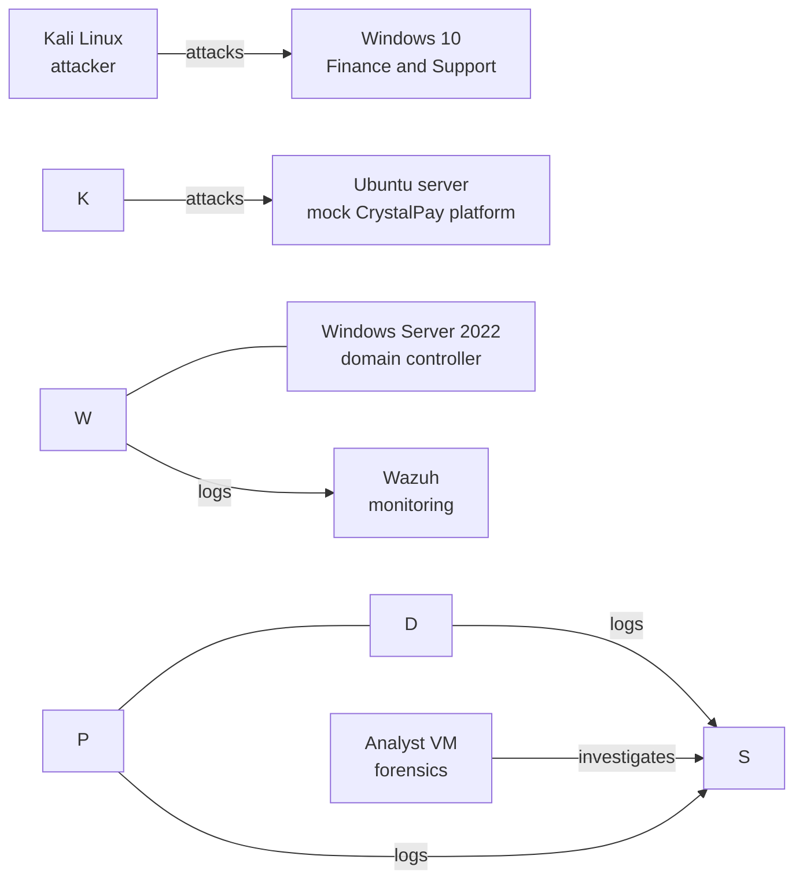

# CrystalPay Security Lab

An attack-and-defend home lab simulating a fictional fintech company, built in VirtualBox to practise SOC skills: detection, incident response, hardening and business continuity.

> \*\*Status:\*\* Phase 1 in progress. See the \[roadmap](#roadmap) below. This README is updated as each phase is completed.

> \*\*Note:\*\* CrystalPay is a fictional company. All customer data, accounts, API keys and credentials in this lab are generated. Nothing here relates to a real system.

## The scenario

**CrystalPay** is a B2B payment gateway. Businesses connect their websites to CrystalPay through API keys, and CrystalPay issues virtual accounts (static and dynamic) that those businesses' customers use to pay. Every transaction flows through the gateway, so a breach has financial, identity and reputational impact.

### Critical assets

|Asset|Why it matters|
|-|-|
|Customer database and KYC records|Identity theft and impersonation|
|Business funds (wallet balances)|Direct financial loss|
|Transaction history|Reveals which businesses perform well, making them targets|
|Virtual accounts|Payment routing; abuse enables fraud|
|API keys|Act as the login for each client website, with no password or MFA step|
|Admin panel|Full control of customers, accounts and funds|

### Departments

* **Finance:** settlements and payouts
* **Customer Support:** customer and KYC queries, high external contact
* **Marketing:** used as a phishing entry point
* **IT / Security:** administers the platform and runs the SOC

## Architecture



|VM|Role|
|-|-|
|Windows Server 2022|Domain controller (Active Directory)|
|Windows 10 (cloned)|Finance and Support workstations|
|Ubuntu server|Mock platform: simple app, database, admin page, fake API keys|
|Kali Linux|Attacker only|
|Wazuh|Monitoring and detection|
|Analyst VM|Forensics, kept separate from the attacker|
|pfSense (later)|Segmentation and firewall during hardening|

## Threat scenarios

|Threat|Lab attack|MITRE ATT\&CK|
|-|-|-|
|Unauthorised access to KYC data|Copy customer records from a share or database|T1039, T1041|
|Compromised credentials used to drain wallets|Password spraying, then abuse of a valid account|T1110.003, T1078|
|Transaction data exposed|Dump the transactions table|T1213|
|API key stolen and abused|Lift the key from a config file, then call the API from Kali|T1552.001|
|Phishing entry point|Phish a marketing user|T1566|

## Roadmap

* \[ ] **Phase 1: Build the company.** Domain, departments, users, workstations, mock platform
* \[ ] **Phase 2: Add the security unit.** Wazuh, Sysmon, log collection from every machine
* \[ ] **Phase 3: Attack.** Run the simulations above and record the timing of each action
* \[ ] **Phase 4: Incident response and forensics.** Investigate from logs, build a timeline, write the incident report
* \[ ] **Phase 5: Hardening.** Segment the network, apply policies, protect API keys, then re-run the attacks to show the improvement
* \[ ] **Phase 6: Business continuity.** Backups, recovery targets (RTO and RPO), a runbook, and a timed restore after a simulated ransomware event

## Repository structure

```
/01-build          setup notes, diagrams, screenshots
/02-monitoring     Wazuh and Sysmon configuration
/03-attacks        what was run, when, and the ATT\&CK mapping
/04-incident-response   timeline, indicators, incident report
/05-hardening      changes made, before and after evidence
/06-continuity     backup design, recovery runbook, restore timings
```

Folders are added as each phase is completed.

## Lessons learned so far

* **Keep attacker and defender separate.** I originally planned to use the attacker machine for investigation as well. Mixing the two contaminates evidence and is unrealistic, so I added a dedicated monitoring VM and a separate analyst VM.
* **Define the business before the infrastructure.** Deciding what the company does and what it must protect made every technical choice easier to justify.

## Safety

The lab runs on isolated virtual networks. Attack tools are used only against the VMs in this lab. Do not use anything here against systems you do not own or have permission to test.

## About

Built by Adeoluwa Agbaakin. Moving into security operations, with an interest in Forensics, cloud security, and GRC.
Connect on LinkedIn link: https://www.linkedin.com/in/agbaakin-adeoluwa-6058b31a9/.

